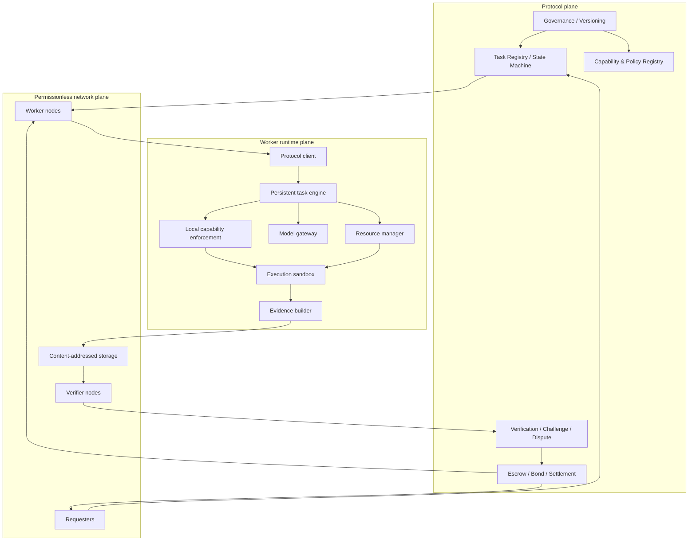

# Reference architecture

## 1. Design intent

IMMORTAL-AEP is a protocol plus interchangeable runtimes, not one privileged daemon. The ledger owns protocol state and economic transitions. Workers execute tasks off-chain. Verifiers evaluate deliveries against a committed profile. Governance changes versioned policy without rewriting funded contracts.

## 2. Logical planes

## 3. Authority boundaries

- The AI model proposes plans and candidate actions. It has no authority to create capabilities, change budgets, sign as the requester, decide final verdicts, or rewrite protocol state.
- The deterministic policy engine checks every operation against the signed Task Manifest and the worker's local safety floor.
- The protocol state machine checks state transitions, commitments and value flows.
- The worker host controls local availability and may refuse work before assignment; after accepting a task it must follow the task's cancellation/exit policy.
- A verifier can submit a verdict but cannot directly move escrow outside the settlement rules.
- Governance can enact new versions according to its public process but cannot change a funded task's committed terms retroactively.

## 4. On-chain / off-chain split

### On-chain

Task identifier, manifest digest, task state, escrow/bond value, role/authorization commitments, deadlines, delivery/evidence/verdict commitments, challenge state, and settlement/refund actions.

### Off-chain

Full manifests when large, datasets, logs, source code, model weights, inference, build/test execution, artifacts, verifier computation, matching, indexing and event delivery. Off-chain references are always content-committed where their integrity matters.

## 5. Cardano first adapter

Use Cardano eUTXO for task escrow and state. Prefer independent per-task UTxOs or carefully partitioned state to avoid a global hot input. Reference inputs can expose read-only shared data; datum/inline datum choices and reference scripts require byte-size and cost testing. Validators must be small deterministic state-transition checks, never general AI runtimes.

The adapter must address concurrent spends, stale transaction builders, retries, idempotency, transaction-size/ExUnits/fee budgets, collateral, timeout boundaries, datum versions, and migration.

## 6. Runtime decomposition

- Protocol client and chain adapter
- Persistent task engine / DAG and checkpoint store
- Capability and policy engine
- Model gateway with pluggable providers
- Resource manager with leases and admission control
- Sandboxed execution environment
- Evidence package builder
- Audit/event journal

The task journal, manifest, protocol events and checkpoints are authoritative. LLM conversation history is disposable and reconstructible.

## 7. Trust and availability assumptions

The protocol must state assumptions per assurance profile. A local worker may be unavailable; storage can disappear; verifiers may collude; chain transactions may race; models are stochastic; GPU computations may differ. The system must produce a defined timeout/recovery outcome for each such failure. It must not equate no response with proof of misconduct.

## Existing implementation integration

The v0.8.0 local agent, Resource Manager, Evolution Manager, Coding Workspace, Flux Point DoD pilot, JEV evidence registry and Mitsuro read-only MCP bridge are preserved as existing implementation assets. Their roles, source paths and security boundaries are mapped in [`EXISTING_LOCAL_NUCLEUS.md`](EXISTING_LOCAL_NUCLEUS.md) and [`../research/REUSE_AND_COMPOSITION_MATRIX.md`](../research/REUSE_AND_COMPOSITION_MATRIX.md). AEP adapters must be added around them before replacements are considered.

## Local-first and compute reciprocity

The first user path is local-only inference without subscription, wallet, account or external API token. An optional reciprocal mesh allows users to contribute spare compute and earn non-transferable usage rights (CRC) for shared inference; a limited community-sponsored pool can serve users who cannot contribute. See [`../economics/COMPUTE_RECIPROCITY.md`](../economics/COMPUTE_RECIPROCITY.md).
